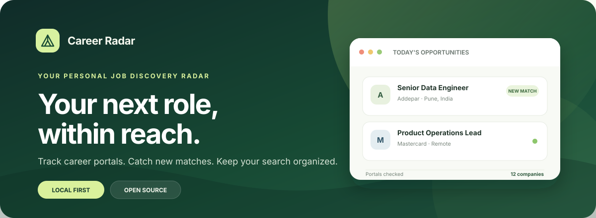
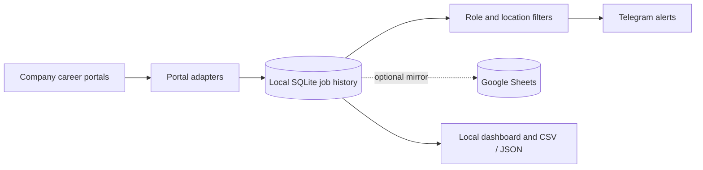

<div align="center">
  
  <br>
  <p><strong>A personal job discovery dashboard that watches career portals, keeps your job history organized, and sends matching roles to Telegram.</strong></p>
  <p>
    
    
    
    <a href=".github/workflows/tests.yml"></a>
  </p>
  <p><a href="#get-started">Get started</a> · <a href="#features">Features</a> · <a href="#supported-portals">Supported portals</a> · <a href="#configuration">Configuration</a></p>
</div>

---

## Find roles without checking every careers page

Career Radar scans the company career sites you choose, applies your role and location filters, and alerts you when it finds a new match. Run it on your own computer; jobs, application notes, and settings stay in your local project unless you enable the optional Google Sheets mirror.



## Features

- **One dashboard for your watchlist** — add or edit companies, filter by keywords and locations, and pause a company with its include switch.
- **Portal-aware scraping** — adapters handle each site's search API, pagination, location facets, and listing structure.
- **Useful job records** — save job links, descriptions, first and last seen dates, and whether a role is still active.
- **Background description enrichment** — fetch full job descriptions without holding up a scan.
- **Telegram alerts** — send new matching roles to a chat, group, or channel. Failed messages remain queued for retry.
- **Application tracking** — record status and personal notes beside each saved job.
- **Export and backup options** — export jobs as CSV or JSON; optionally mirror the complete job history to Google Sheets.
- **Maintenance signals** — recognizable portal structure changes show as scan issues in the dashboard and logs.
- **Local-first storage** — SQLite is the source of truth; the dashboard listens on `127.0.0.1` by default.

## Get started

### 1. Install

Python 3.10 or newer is required.

```bash
git clone <repository-url>
cd JobPortalScraper
python3 -m venv .venv
source .venv/bin/activate        # Windows: .venv\Scripts\activate
python -m pip install -e .
```

### 2. Open the dashboard

```bash
python start_dashboard.py
```

The dashboard opens in your browser at [http://127.0.0.1:8765](http://127.0.0.1:8765). Keep the terminal window open while monitoring. Add a company, optionally set filters, then choose **Start monitoring** or **Scan now**.

The first successful scan creates a quiet baseline of current openings. Later scans alert on new matching roles. With no filters, every role qualifies. A configured keyword filter requires at least one keyword match; a configured location filter requires at least one location match.

### 3. Connect Telegram

Create a bot with [@BotFather](https://t.me/BotFather), add it to the destination chat, and grant it permission to post. In **Settings**, enter both the bot token and the destination chat ID, save, then choose **Send a test**.

- Public channels can use their `@channelname`.
- Private channels and groups use a numeric chat ID, often beginning with `-100`.
- For a direct message, open the bot and press **Start** first.

The bot token is stored locally in the ignored `settings.json` file. The dashboard clears the password field after saving; its saved-token hint confirms the token is still configured. Keep this file private.

## Supported portals

| Portal | Notes |
| --- | --- |
| **Addepar** | Embedded Greenhouse board; requests full description content. |
| **BlackRock** | Paginated TalentBrew results with location matching and JD loading. |
| **bp** | Algolia listings, location facets, and detail-page descriptions. |
| **Citi** | TalentBrew search, location autocomplete, and job details. |
| **FIS Global** | Phenom search results and city facets. |
| **Greenhouse** | Public board API, including embedded company widgets. |
| **Mastercard** | Phenom search results and location filtering. |
| **State Street** | Phenom search results and location filtering. |
| **UBS** | IBM BrassRing embedded search and location facets. |
| **Workday** | `myworkdayjobs.com` and `myworkdaysite.com`, with location facets and canonical job links. |
| **Other sites** | Generic structured job data and likely job links, with optional browser fallback. |

Portals can change independently. When a supported adapter no longer recognizes a page, Career Radar reports an issue so it can be maintained. A valid page with no current openings is treated as a successful scan.

## Configuration

### Company filters and scan controls

Use **Add a company** in the dashboard, or manage companies from the CLI:

```bash
job-scraper company add "Acme" "https://boards.greenhouse.io/acme" \
  --keyword engineer --keyword analyst --location Pune
job-scraper company list
job-scraper company remove "Acme"
```

Repeat `--keyword` or `--location` to add alternatives. You can pause a company in the dashboard without deleting it; its saved jobs stay intact and queued alerts wait until it is included again.

Run a one-time scan or continuous monitoring from the terminal:

```bash
job-scraper scan
job-scraper run                  # scans immediately, then every 30 minutes
job-scraper --interval 900 run   # every 15 minutes
```

### Optional JavaScript browser support

Install this only when a portal requires browser-rendered results. State Street, FIS, and Mastercard use this fallback:

```bash
python -m pip install -e ".[browser]"
python -m playwright install chromium
```

### Optional Google Sheets mirror

SQLite remains authoritative. The mirror updates a `Jobs` tab with saved jobs, full descriptions, inactive history, alert/application status, and notes.

1. Create a Google service account and enable the Google Sheets API for its Cloud project.
2. Create a JSON key and store it somewhere private. Do not commit it.
3. Set the key path in a project-root `.env` file:

   ```dotenv
   GOOGLE_SERVICE_ACCOUNT_FILE=/path/to/private/service-account.json
   ```

4. Install the optional dependency:

   ```bash
   python -m pip install -e ".[google]"
   ```

5. Create a spreadsheet in your Drive. Share it with the service account's `client_email` as an **Editor**, then paste the spreadsheet URL or ID into **Settings → Google Sheets master spreadsheet**.

Sync runs in the background; Google errors do not stop scans and failed updates remain queued for retry. The app loads values from the project `.env` at startup. Environment variables already set by the process take precedence.

### Local files

| File | Purpose |
| --- | --- |
| `companies.json` | Company URLs, filters, and include/exclude settings. |
| `jobs.sqlite3` | Job history, descriptions, application notes, and sync queue. |
| `settings.json` | Dashboard preferences and locally saved Telegram settings. |
| `logs/job-scraper.log` | Dashboard and scan logs. |
| `.env` | Optional local environment variables; ignored by Git. |

Back up the files you want to keep. The Google Sheet is an optional mirror, not a replacement for the local database.

## Develop and test

Install the development tools and run the offline regression suite:

```bash
python -m pip install -e ".[dev]"
python -m pytest                       # full suite
python -m pytest tests/test_scrapers.py # one test module
python -m pytest tests/test_scrapers.py -k workday  # selected tests
```

Portal tests use saved fixtures and mocked responses; they do not need live career sites. The GitHub Actions workflow runs the suite on pushes and pull requests.

### Add a portal adapter

1. Add an adapter module under `job_scraper/portals/`.
2. Register its hostname and handler in `job_scraper/portals/registry.py`.
3. Add offline fixtures and tests for routing, listing parsing, locations, pagination, empty results, and structure changes. Add JD coverage when the portal has a separate detail source.
4. Raise `PortalStructureError` when the expected listing structure disappears; return an empty list for a valid empty result.

Keep the public `PortalScraper.fetch(url, locations)` entry point stable so one portal's changes stay isolated from the others.

## Troubleshooting

- **A company shows an issue:** check its latest error in the dashboard and `logs/job-scraper.log`. Portal markup or an API response may have changed.
- **No Telegram message:** verify both credentials, add the bot to the destination, and use **Send a test** to see Telegram's response.
- **Google Sheets returns 403:** share the spreadsheet with the service account as an Editor and check that the Sheets API is enabled.
- **A portal shows zero jobs:** confirm the company URL and location filters. An incorrect location label can exclude otherwise valid roles.
- **Monitoring stops when you close Terminal:** the local dashboard runs in that process. Relaunch it with `python start_dashboard.py`.

## License

No license file is currently included. Add a `LICENSE` file before distributing or accepting external contributions.
